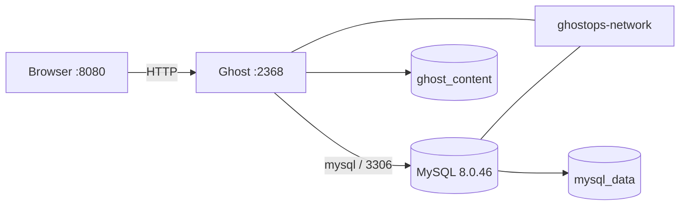

# GhostOps CI/CD

Proyecto académico que despliega Ghost CMS y MySQL en contenedores independientes, conectados por una red privada de Docker. La aplicación usa el nombre DNS del servicio `mysql` para conectarse a la base de datos.

## Arquitectura



| Servicio | Función | Imagen |
|---|---|---|
| `ghost` | Aplicación web; imagen propia construida desde la imagen oficial Ghost 6.0.0 Alpine | `ghostops-app:1.0.0` |
| `mysql` | Base de datos relacional con almacenamiento persistente | `mysql:8.0.46` |

El Dockerfile reutiliza Ghost y sus dependencias ya instaladas por la imagen oficial; define explícitamente el directorio, el puerto y el comando de inicio.

Compose configura la red `ghostops-network`, publica Ghost en `http://localhost:8080`, conserva los datos en volúmenes y espera a que MySQL esté saludable antes de iniciar Ghost. MySQL no publica su puerto en el host.

## Requisitos

- Docker Desktop con Docker Compose V2.
- Git.

## Levantar los contenedores

Desde PowerShell, clona el repositorio y entra al directorio:

```powershell
git clone https://github.com/JonathanFrancoS/GhostOpsCICD.git
Set-Location GhostOpsCICD
Copy-Item .env.example .env
```

Edita `.env` y sustituye los valores de ejemplo por contraseñas propias. El archivo `.env` está excluido de Git y del contexto de construcción; no uses las contraseñas de ejemplo en despliegues.

```powershell
docker compose config --quiet
docker compose build
docker compose up --detach --wait
docker compose ps
```

Abre `http://localhost:8080/ghost` y completa la configuración inicial del sitio. Ghost quedará disponible en `http://localhost:8080/`.

Para apagar los servicios sin borrar datos:

```powershell
docker compose down
```

Para eliminar también los volúmenes persistentes y todos los datos:

```powershell
docker compose down --volumes
```

## Verificaciones y comunicación real

La conexión de Ghost usa `database__connection__host: mysql`; `mysql` es el nombre del servicio dentro de la red Compose, no `localhost` ni una IP fija.

1. En `http://localhost:8080/ghost`, configura el usuario administrador, crea una publicación de prueba titulada **Prueba de comunicación Ghost MySQL** con slug `prueba-comunicacion` y publícala.
2. Comprueba que la publicación es visible desde la aplicación en `http://localhost:8080/prueba-comunicacion/`.
3. Ejecuta el verificador desde PowerShell. Consulta el registro en MySQL y comprueba que Ghost sirve la publicación:

   ```powershell
   .\scripts\verify-communication.ps1 -Slug prueba-comunicacion
   ```

El script imprime la fila consultada y el estado HTTP de la página. La publicación creada desde Ghost, persistida en MySQL y servida de regreso demuestra el flujo de escritura y lectura entre servicios.

Comandos útiles para capturas:

```powershell
docker build --tag ghostops-app:1.0.0 .
docker compose up --detach --wait
docker compose ps
docker network inspect ghostops-network
docker compose logs --tail 100 ghost mysql
```

La prueba de comunicación es la publicación accesible desde Ghost y su fila consultable en MySQL. Conserva las capturas y sus pies de figura APA en [`screenshot/`](screenshot/).

## Integración continua

El workflow [`.github/workflows/ci.yml`](.github/workflows/ci.yml) se ejecuta en cada push y pull request. Valida Compose, construye la imagen de Ghost, levanta ambos servicios, comprueba la respuesta HTTP y verifica que Ghost haya inicializado la tabla `posts` en MySQL. Para la ejecución de CI se usan credenciales temporales de prueba, no secretos personales.

## Estructura relevante

```text
.
├── .github/workflows/ci.yml
├── docker/mysql/
├── docs/
│   ├── arquitectura/
│   ├── entregas/entrega-1.md
│   └── evidencias/entrega-1/
├── screenshot/
│   └── Capturas locales y pies de figura APA
├── Dockerfile
├── compose.yaml
└── .env.example
```

## Referencias

- Docker, Inc. (s. f.). *Docker Compose overview*. Docker Documentation. https://docs.docker.com/compose/
- Docker, Inc. (s. f.). *Dockerfile reference*. Docker Documentation. https://docs.docker.com/reference/dockerfile/
- Ghost Foundation. (s. f.). *Ghost*. https://ghost.org/
- Oracle. (s. f.). *MySQL 8.0 Reference Manual*. https://dev.mysql.com/doc/refman/8.0/en/
