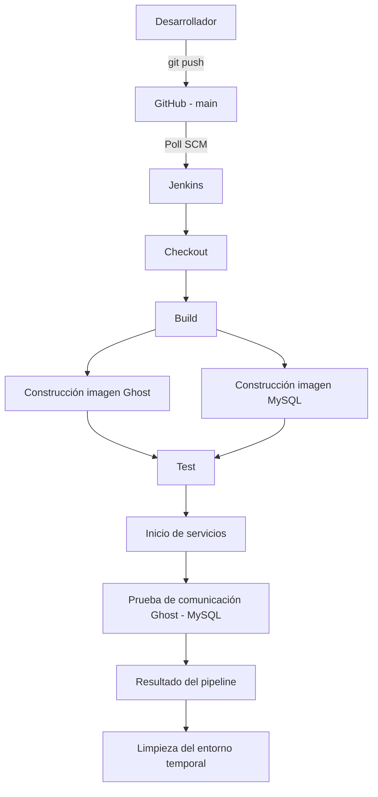

# Entrega 2 - Integración continua con Jenkins y Docker

## Objetivo

Implementar un entorno de integración continua utilizando Jenkins para automatizar la descarga del código fuente desde GitHub, la construcción de las imágenes Docker de Ghost y MySQL y la ejecución de pruebas de comunicación entre ambos servicios.

La solución incorpora un pipeline definido como código mediante un archivo `Jenkinsfile`, credenciales administradas desde Jenkins y detección automática de cambios en el repositorio mediante Poll SCM.

## Descripción del proyecto

El proyecto continúa la infraestructura desarrollada en la primera entrega, basada en Ghost CMS y MySQL como servicios independientes.

Para esta segunda entrega se incorpora Jenkins como herramienta de automatización. El pipeline obtiene el código desde el repositorio GitHub `GhostOpsCICD`, construye las imágenes de los servicios, inicia un entorno aislado para las pruebas y comprueba la comunicación entre Ghost y MySQL.

Repositorio: [GhostOpsCICD - GitHub](https://github.com/JonathanFrancoS/GhostOpsCICD).

## Arquitectura

La solución está compuesta por los siguientes elementos:

- **GitHub:** aloja el código fuente, los archivos Docker y el `Jenkinsfile`.
- **Jenkins:** administra y ejecuta el pipeline de integración continua.
- **Docker-in-Docker (DinD):** proporciona un motor Docker aislado para que Jenkins construya imágenes y ejecute los servicios durante las pruebas.
- **Ghost:** aplicación web construida a partir de Ghost 6.0.0 Alpine.
- **MySQL:** base de datos relacional basada en MySQL 8.0.46.
- **Poll SCM:** consulta periódicamente el repositorio GitHub para detectar nuevos cambios.

El flujo de integración es:



## Requisitos de hardware y software

### Hardware

- Equipo de desarrollo con Windows 11.
- Recursos de procesador, memoria RAM y almacenamiento suficientes para ejecutar Docker Desktop, Jenkins y los contenedores del proyecto.

Completar con las características reales del equipo utilizado en la práctica:

- Procesador: [Completar].
- Memoria RAM: [Completar].
- Almacenamiento disponible: [Completar].

### Software

| Herramienta | Uso |
|---|---|
| Windows 11 | Sistema operativo del entorno de desarrollo |
| Docker Desktop | Administración del entorno de contenedores |
| Docker Engine | Construcción y ejecución de imágenes y contenedores |
| Docker Compose | Orquestación de servicios |
| Git | Control de versiones |
| GitHub | Alojamiento del repositorio |
| Jenkins LTS con JDK 21 | Automatización del pipeline |
| Ghost 6.0.0 Alpine | Aplicación web |
| MySQL 8.0.46 | Base de datos |

## Instalación y configuración de Jenkins

Jenkins se implementó mediante Docker Compose utilizando una imagen personalizada construida desde `jenkins/jenkins:lts-jdk21`.

La imagen personalizada incorpora:

- Docker CLI.
- Docker Compose Plugin.
- Complementos necesarios para GitHub, Pipeline y Docker.

El entorno de Jenkins utiliza un servicio Docker-in-Docker para ejecutar las operaciones de construcción y prueba de forma aislada.

El archivo de configuración utilizado es `compose.jenkins.yaml`, mientras que la construcción de la imagen personalizada se define en `docker/jenkins/Dockerfile`.

Jenkins se publica localmente en:

`http://localhost:8081`

El servicio Ghost de la infraestructura principal conserva su puerto:

`http://localhost:8080`

La comunicación de Jenkins con Docker-in-Docker utiliza el puerto interno 2376 con TLS.

## Complementos de Jenkins

Se instalaron los siguientes complementos:

| Complemento | Función |
|---|---|
| Git | Integración con repositorios Git |
| GitHub | Funcionalidades de integración con GitHub |
| Pipeline | Definición y ejecución de pipelines como código |
| Docker Pipeline | Integración de pipelines con Docker |
| Credentials Binding | Uso seguro de credenciales durante las ejecuciones |

## Gestión de credenciales

Las contraseñas de MySQL se almacenan en el almacén de credenciales de Jenkins como valores secretos.

Identificadores configurados:

- `ghostops-mysql-password`
- `ghostops-mysql-root-password`

El `Jenkinsfile` recupera estas credenciales durante la ejecución mediante el mecanismo de credenciales de Jenkins.

El archivo `.env` permanece excluido del repositorio Git. No se deben incluir contraseñas reales en el documento ni en las capturas de pantalla.

## Pipeline como código

El archivo `Jenkinsfile`, ubicado en la raíz del repositorio, define las etapas del proceso de integración continua.

### Checkout

Descarga el código fuente desde el repositorio GitHub mediante `checkout scm`.

### Build

Realiza la validación de la configuración Docker Compose y construye las imágenes de los servicios Ghost y MySQL.

Comandos principales:

```bash
docker compose -f compose.yaml config --quiet
docker compose -f compose.yaml build mysql ghost
```

### Test

Inicia los servicios con Docker Compose y espera a que estén disponibles.

Posteriormente, comprueba la comunicación TCP desde el contenedor Ghost hacia el servicio MySQL utilizando el nombre DNS interno `mysql` y el puerto 3306.

Si la conexión falla o se agota el tiempo de espera, la etapa de pruebas termina con error.

### Post

El bloque `post` ejecuta la limpieza del entorno temporal de pruebas, retirando los contenedores, la red y los volúmenes asociados al proyecto aislado de CI.

Esta limpieza se realiza dentro de Docker-in-Docker y no elimina los volúmenes de la infraestructura principal de Ghost.

## Integración automática con GitHub

El trabajo `GhostOpsCICD-Pipeline` se configuró en Jenkins utilizando:

- Definición: Pipeline script from SCM.
- Sistema de control de versiones: Git.
- Repositorio: `https://github.com/JonathanFrancoS/GhostOpsCICD.git`.
- Rama: `main`.
- Ruta del script: `Jenkinsfile`.

La detección automática de cambios se configuró mediante Poll SCM con la expresión:

```text
H/2 * * * *
```

Esta programación permite consultar el repositorio aproximadamente cada dos minutos.

Para comprobar su funcionamiento se publicó una actualización documental en `README.md` y se verificó que Jenkins iniciara una nueva ejecución sin utilizar manualmente la opción Build Now.

## Pruebas y resultados

Se realizaron las siguientes verificaciones:

1. Validación de la configuración Docker Compose.
2. Construcción de las imágenes de Ghost y MySQL.
3. Inicio de ambos servicios en el entorno aislado de pruebas.
4. Verificación de disponibilidad mediante Docker Compose.
5. Prueba de comunicación entre Ghost y MySQL utilizando el nombre del servicio `mysql` y el puerto 3306.
6. Limpieza del entorno temporal de CI.
7. Ejecución manual y automática del pipeline.

Durante la primera ejecución se identificó un problema de codificación UTF-8 BOM al inicio del archivo `Jenkinsfile`. Se corrigió el archivo, se publicó el cambio en GitHub y se comprobó posteriormente la ejecución satisfactoria del pipeline.

La prueba de integración automática se realizó mediante un nuevo commit documental y la detección del cambio por Poll SCM.

## Evidencias para el PDF

Guardar las capturas en las carpetas indicadas dentro de `docs/evidencias/entrega-2-jenkins/`.

Los siguientes nombres y pies de figura sirven como índice de evidencias en formato APA. Incorporar únicamente las capturas que efectivamente se hayan tomado.

### 01. Preparación

1. `01-preparacion/01-dockerfile-mysql.png`: creación del Dockerfile personalizado para el servicio MySQL.
2. `01-preparacion/02-compose-dos-servicios.png`: configuración de construcción de imágenes Docker para Ghost y MySQL.
3. `01-preparacion/03-imagenes-construidas.png`: imágenes personalizadas de Ghost y MySQL construidas mediante Docker.

### 02. Instalación

4. `02-instalacion/05-compose-jenkins-validado.png`: configuración de los servicios Jenkins y Docker-in-Docker mediante Docker Compose.
5. `02-instalacion/06-imagen-jenkins-construida.png`: construcción de la imagen personalizada de Jenkins con Docker CLI y Docker Compose.
6. `02-instalacion/07-herramientas-jenkins-verificadas.png`: verificación de Docker CLI, Docker Compose y complementos instalados en la imagen personalizada de Jenkins.
7. `02-instalacion/08-jenkins-contenedores-iniciados.png`: inicio de los contenedores Jenkins y Docker-in-Docker mediante Docker Compose.
8. `02-instalacion/09-jenkins-acceso-web.png`: verificación del estado de los contenedores y disponibilidad web de Jenkins.
9. `02-instalacion/10-jenkins-inicializado.png`: configuración inicial y acceso al panel de administración de Jenkins.
10. `02-instalacion/16-jenkins-docker-conexion-verificada.png`: verificación de la comunicación entre Jenkins y el motor Docker-in-Docker mediante Docker CLI y Docker Compose.

### 03. Configuración

11. `03-configuracion/11-plugins-jenkins-verificados.png`: verificación de los complementos instalados para GitHub, Pipeline y Docker.
12. `03-configuracion/12-credenciales-jenkins.png`: almacenamiento seguro de las credenciales de conexión a MySQL en Jenkins.

### 04. GitHub

13. `04-github/14-github-commit-publicado.png`: publicación del pipeline de integración continua y archivos de configuración Docker en GitHub.
14. `04-github/15-jenkins-pipeline-conectado-github.png`: configuración del trabajo Pipeline de Jenkins mediante conexión al repositorio GitHub.
15. `04-github/19-github-correccion-jenkinsfile-publicada.png`: publicación de la corrección de codificación UTF-8 del archivo Jenkinsfile.
16. `04-github/23-jenkins-poll-scm-configurado.png`: configuración de la consulta periódica del repositorio GitHub mediante Poll SCM.
17. `04-github/24-git-cambio-readme-preparado.png`: preparación de una actualización documental en el repositorio local para verificar Poll SCM.
18. `04-github/25-git-commit-prueba-poll-scm.png`: registro del commit utilizado para comprobar la detección automática de cambios.
19. `04-github/26-jenkins-deteccion-automatica-poll-scm.png`: detección automática de una actualización del repositorio e inicio de una nueva ejecución.
20. `04-github/28-git-estado-final-sincronizado.png`: verificación del repositorio sincronizado con GitHub y sin cambios pendientes.

### 05. Pipeline

21. `05-pipeline/13-jenkinsfile-estructura.png`: definición del pipeline como código para automatizar las etapas Checkout, Build y Test.
22. `05-pipeline/20-jenkins-stage-view-pipeline-exitoso.png`: visualización de las etapas Checkout, Build y Test ejecutadas satisfactoriamente.

### 06. Pruebas

23. `06-pruebas/04-servicios-ghost-mysql.png`: verificación del estado de salud y disponibilidad HTTP de los servicios Ghost y MySQL.

### 07. Resultados

24. `07-resultados/17-jenkins-primera-ejecucion-fallida.png`: registro de la primera ejecución fallida del pipeline.
25. `07-resultados/18-jenkins-error-codificacion-jenkinsfile.png`: identificación del error de codificación BOM en el archivo Jenkinsfile.
26. `07-resultados/21-jenkins-consola-pipeline-exitoso.png`: registro de consola de Jenkins que evidencia la ejecución satisfactoria.
27. `07-resultados/22-jenkins-historial-fallo-y-exito.png`: historial de ejecuciones que evidencia la identificación y corrección de un error.
28. `07-resultados/27-jenkins-pipeline-automatico-exitoso.png`: ejecución satisfactoria del pipeline iniciada automáticamente tras detectar un cambio en GitHub.

## Conclusiones

La implementación permitió integrar Jenkins con GitHub y Docker para automatizar la construcción y validación de los servicios Ghost y MySQL.

La definición del pipeline como código facilita la repetición del proceso y mantiene las etapas de descarga, construcción y pruebas organizadas.

La prueba de comunicación mediante el nombre DNS `mysql` permitió comprobar que Ghost puede establecer una conexión con la base de datos dentro de la red de Docker Compose.

La configuración de Poll SCM permitió comprobar la detección periódica de cambios publicados en GitHub y el inicio automático de una nueva ejecución.

Finalmente, el uso de Docker-in-Docker permitió aislar el entorno temporal de integración continua de los contenedores y volúmenes de la infraestructura principal.

## Referencias

Docker, Inc. (s. f.). *Docker Compose overview*. Docker Documentation. https://docs.docker.com/compose/

Docker, Inc. (s. f.). *Dockerfile reference*. Docker Documentation. https://docs.docker.com/reference/dockerfile/

Ghost Foundation. (s. f.). *Ghost*. https://ghost.org/

Jenkins. (s. f.). *Jenkins User Documentation*. https://www.jenkins.io/doc/

Jenkins. (s. f.). *Pipeline Syntax*. https://www.jenkins.io/doc/book/pipeline/syntax/

Oracle. (s. f.). *MySQL 8.0 Reference Manual*. https://dev.mysql.com/doc/refman/8.0/en/